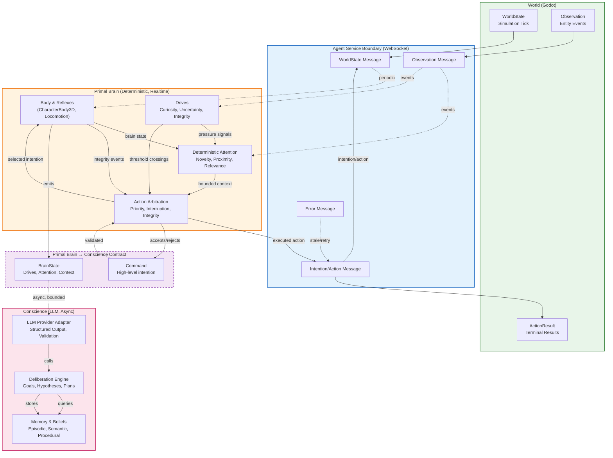
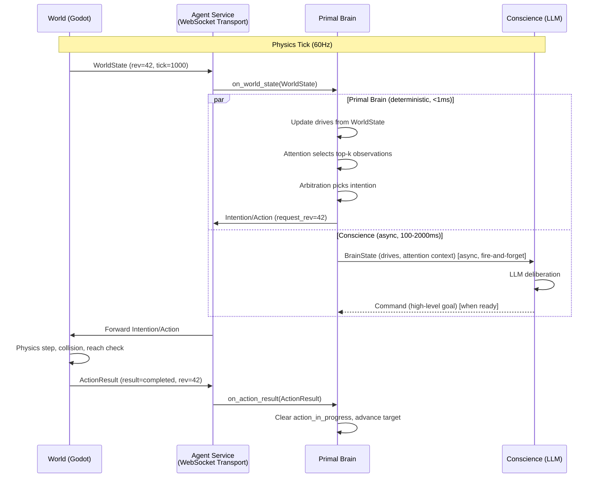

# Agent Control Layers Architecture

**Status:** Draft (derived from ADR 0002 + backlog items)  
**Related:** ADR 0002, TODO-0008, TODO-0013, TODO-0014, TODO-0015, TODO-0016, TODO-0017, TODO-0018

---

## Component Diagram



---

## Sequence Diagram: Typical Tick



---

## Component Responsibilities

### Primal Brain (Deterministic, Realtime)

| Component | Responsibility | Backlog | Key Outputs |
|-----------|----------------|---------|-------------|
| **Body & Reflexes** | Locomotion, collision avoidance, reach validation, action execution | TODO-0008 ✅ | `BrainState.kinematics`, `ActionResult` |
| **Drives** | Curiosity, Uncertainty, Physical Integrity - update rules, thresholds | TODO-0013 | `BrainState.drives[]`, threshold events |
| **Attention** | Score observations (novelty, proximity, drive/goal relevance), emit bounded context | TODO-0014 | `BrainState.attention_context[]` |
| **Arbitration** | Priority: Integrity > Reflex > Plan > Exploration; interruption/resume rules | TODO-0015 | `selected_intention`, `interrupted_intentions[]` |

### Conscience (LLM, Async)

| Component | Responsibility | Backlog | Key Outputs |
|-----------|----------------|---------|-------------|
| **LLM Adapter** | Provider abstraction, structured output, validation, retries, cost tracking | TODO-0017 | Validated `Command` or error |
| **Deliberation** | Goal formation, hypothesis generation, plan decomposition | TODO-0017 | `Command.goal`, `Command.plan[]` |
| **Memory & Beliefs** | Episodic (events), Semantic (facts), Procedural (skills), Evidence linking | TODO-0018 | Retrieval results for deliberation |

### Contract: Primal Brain ↔ Conscience

```typescript
// BrainState - emitted by Primal Brain at ~10Hz (configurable)
interface BrainState {
  timestamp_s: number;
  world_revision: number;
  
  // Kinesthetic state
  kinematics: {
    position: Vector3;
    velocity: Vector3;
    heading: number;
  };
  
  // Drive pressures [0, 1]
  drives: {
    curiosity: number;
    uncertainty: number;
    integrity: number;
  };
  
  // Attention output (bounded, e.g., top 5)
  attention_context: Array<{
    entity_id: string;
    score: number;
    factors: { novelty: number; proximity: number; relevance: number };
  }>;
  
  // Current arbitration state
  arbitration: {
    active_intention_id?: string;
    pending_intentions: string[];
    interrupted_intentions: string[];
  };
}

// Command - sent by Conscience (async, no fixed rate)
interface Command {
  id: string;
  timestamp_s: number;
  type: "goal" | "plan" | "hypothesis" | "inspect" | "abort";
  
  // Goal/plan content
  goal?: string;
  plan?: Array<{ step: string; expected_outcome: string }>;
  target_entity_id?: string;
  
  // Metadata
  confidence: number;      // [0,1]
  source: "llm" | "mock";
  correlation: CorrelationContext;
}
```

---

## Data Flow Summary

```
┌─────────────────────────────────────────────────────────────────┐
│                    WORLD (Godot, 60Hz)                         │
│  Physics, Entities, Collision, Reach Validation                │
└──────────────────────────┬──────────────────────────────────────┘
                           │ WorldState, Observation, ActionResult
                           ▼
┌─────────────────────────────────────────────────────────────────┐
│              AGENT SERVICE (WebSocket)                         │
│  Correlation, Retry, Stale-Rejection, Reconnection             │
└──────────────────────────┬──────────────────────────────────────┘
                           │
         ┌─────────────────┴─────────────────┐
         ▼                                   ▼
┌─────────────────────────┐         ┌─────────────────────────┐
│    PRIMAL BRAIN         │         │      CONSCIENCE         │
│  (Deterministic, <1ms)  │◄───────►│    (LLM, Async)         │
│                         │  Contract│                         │
│  • Body & Reflexes      │         │  • LLM Adapter          │
│  • Drives               │  Brain-  │  • Deliberation         │
│  • Attention            │  State   │  • Memory & Beliefs     │
│  • Arbitration          │  Command │                         │
└───────────┬─────────────┘         └─────────────────────────┘
            │ Intention/Action
            ▼
┌─────────────────────────────────────────────────────────────────┐
│                    WORLD (Godot)                                │
└─────────────────────────────────────────────────────────────────┘
```

---

## Implementation Status

| Layer | Component | Status | Location |
|-------|-----------|--------|----------|
| **World** | Physics, Room, Entities | ✅ Done | `apps/world/src/room.gd` |
| **World** | Agent (CharacterBody3D) | ✅ Done | `apps/world/src/agent.gd` |
| **World** | MockController (reflexes) | ✅ Done | `apps/world/src/mock_controller.gd` |
| **Transport** | AgentService (WebSocket) | ✅ Done | `services/agent/src/agent_service.py` |
| **Transport** | MockAgent (protocol test double) | ✅ Done | `services/agent/src/mock_agent.py` |
| **Primal** | Body & Reflexes | ✅ Done | Godot (above) |
| **Primal** | Drives | 📋 Backlog | TODO-0013 |
| **Primal** | Attention | 📋 Backlog | TODO-0014 |
| **Primal** | Arbitration | 📋 Backlog | TODO-0015 |
| **Primal** | MockBrain (deterministic intention contract) | 📋 Backlog | TODO-0016 |
| **Conscience** | LLM Adapter | 📋 Backlog | TODO-0017 |
| **Conscience** | Memory & Beliefs | 📋 Backlog | TODO-0018 |

---

## Next Steps (Priority Order)

1. **TODO-0012** - Expose foundational health/metrics (prerequisite for drives)
2. **TODO-0013** - Implement three initial drives
3. **TODO-0014** - Implement deterministic attention
4. **TODO-0015** - Implement action arbitration
5. **TODO-0016** - Add mock brain (deterministic intention contract)
6. **TODO-0017** - Add LLM provider adapter
7. **TODO-0018** - Implement layered memory

---

*Generated from ADR 0002 and backlog items. Update when components are implemented.*